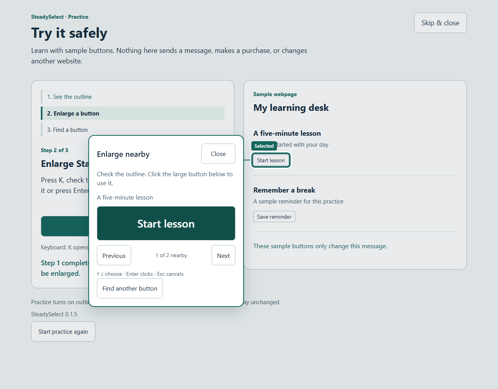

# SteadySelect

**Point approximately. Click deliberately.**

SteadySelect is a Chrome extension that turns small webpage buttons and links into large, clear choices. Move near a control to preview it, open an enlarged action card, then confirm. Or search the page's supported actions in one keyboard-friendly list.

Built solo for [Taskforge 2026](https://taskforge.devpost.com/) with assistance from OpenAI Codex. **Working prototype · version 0.1.5 · no account, backend, or API key.**

[Download source ZIP](https://github.com/DaDocterTaco/SteadySelect/archive/refs/heads/main.zip) · [Public test page](https://dadoctertaco.github.io/SteadySelect/) · [Installation & quick test](#install-and-try-it-in-chrome) · [How it works](docs/ARCHITECTURE.md) · [Testing evidence](docs/TESTING.md)



## Who it is for

The intended user is someone who finds precise pointer placement or small controls difficult, including people with shaky hands or reduced vision. The prototype addresses one task barrier: selecting the intended button or link without having to land directly on its small target.

It provides another way to interact with existing pages. It does not move the operating-system pointer or magnify arbitrary text. Intended-user research and usability validation are still needed; no clinical benefit or WCAG conformance is claimed.

## Install and try it in Chrome

1. [Download the repository ZIP](https://github.com/DaDocterTaco/SteadySelect/archive/refs/heads/main.zip) and extract it, or clone this repository.
2. In Chrome, open `chrome://extensions` and turn on **Developer mode**.
3. Click **Load unpacked** and select the **extension** folder inside the extracted repository. It contains `manifest.json`. Select that folder, not the repository root.
4. Pin SteadySelect from Chrome's puzzle-piece Extensions menu.
5. Click its toolbar icon, then **Try it safely**. Complete the three-step practice: outline, enlarge **Start lesson**, then find **Save reminder**. The practice controls only change local messages.
6. Open an ordinary webpage, click SteadySelect, and choose **Turn on for this page**. Move near a harmless button or link, then use **Enlarge nearby** or **Find a button**.

**No npm install or build step is needed to use the extension.** This is an unpacked prototype, not a Chrome Web Store listing. Enable it again after a full page navigation or reload.

After installing, open the [public test page](https://dadoctertaco.github.io/SteadySelect/) and enable SteadySelect there. Its lesson buttons only update sample messages. The webpage alone does not run the extension; installation is required.

For local testing, use the repository's `demo/index.html`. Local files require Chrome's **Allow access to file URLs** setting; the built-in **Try it safely** walkthrough does not. You can also serve the repository with `python -m http.server 8000` and visit `http://localhost:8000/demo/`.

## The core interaction

| Tool | What it does |
| --- | --- |
| Live outline | Shows the nearest supported action as the mouse moves. It never clicks by itself. |
| Enlarge nearby | Opens a stationary, enlarged action card; confirm with its large button or Enter. |
| Find a button | Searches supported buttons and links. Start with On screen or choose Whole page for loaded controls. |
| Escape / Close | Cancels without activating the webpage control. |
| Settings & help | Adjusts outline visibility, text size, button size and letter shortcuts. |
| Collapse tools / Move to other corner | Keeps the toolbar out of the way without requiring dragging. |
| Try it safely | Teaches the real interaction in a separate practice tab. |

Default modifier shortcuts are **Alt+Shift+S** to toggle, **Alt+Shift+K** to enlarge, and **Alt+Shift+L** to find. Chrome may leave a shortcut unassigned if it conflicts with another extension. The popup shows the current bindings.

Plain **K/L are optional** and initially off. Enable them in Settings & help, or remap them in the popup. They preserve ordinary typing in text fields. Large on-page controls offer mouse alternatives to shortcuts.

The selected action stays fixed while its panel is open. If the target changes, becomes disabled or is no longer safe to select, the extension asks you to choose again. An offscreen result is revealed first and requires a second confirmation.

## Privacy

Everything runs locally. There is no runtime AI, analytics, remote code, server, or account. Page labels and pointer coordinates stay in the current page's memory; only preferences are saved. Permissions are exactly **activeTab**, **scripting**, and **storage**, with no ongoing host permissions. [Privacy details](PRIVACY.md).

## Prototype use notice

SteadySelect is experimental software provided for evaluation. To the extent permitted by applicable law, it is provided "as is" without warranties of any kind. Correct operation, availability and compatibility with every website are not guaranteed. Nothing in this notice excludes rights or protections that cannot lawfully be excluded.

SteadySelect is not intended to diagnose, treat, cure or prevent a medical condition. No clinical benefit or accessibility certification is claimed.

Confirming an assisted action activates the original website control and can have the same consequences as clicking it directly. Read the selected label before confirming, especially before sending information, spending money or deleting data. Start with **Try it safely**; cancel or disable the extension if the selected target is wrong. The original website's terms and privacy practices still apply.

See [Privacy and permissions](PRIVACY.md) for data handling and the [license](LICENSE) for permitted use.

## What works and what does not

Supported: labeled native buttons, links, button inputs, checkboxes, radio buttons and HTML controls with `role="button"`, including supported controls inside open shadow roots. Styled inputs can use their visible labels. Context helps distinguish repeated names.

Unsupported: Chrome's internal pages, the Web Store, browser/OS UI, embedded frames, closed shadow roots, canvas controls, unlabeled actions and arbitrary custom widgets. Some sites reject programmatic clicks or dismiss menus when focus moves. The extension cannot guarantee every site's behavior. It is not a screen reader, general text magnifier, or system-wide tremor filter.

## Evidence

Version 0.1.5 passed **74 automated checks** on October 24, 2026: 53 local integration checks, 14 checks across Wikipedia, GitHub and MDN, and 7 W3C custom-button checks. Toolbar behavior was also checked in an installed Chrome profile; the builder completed the installed practice walkthrough. [Exact scope and reports](docs/TESTING.md).

These are functional checks, not a study with the intended users. The next milestone is testing with people who experience the target barrier and improving the product from their feedback.

## Develop and test

Requires Node.js 20+ for development tests only:

```sh
npm ci
npx playwright install chromium
npm run check
npm test
```

`npm test` runs the 53 local integration checks in an isolated Chromium profile. `npm run test:sites` and `npm run test:custom` exercise public sites and need network access. Live websites can change. See [TESTING.md](docs/TESTING.md) for details and Linux setup.

To edit the extension, change files in `extension/`, click **Reload** on its Chrome extensions card, refresh the webpage, and enable it again. `npm run package` creates a release folder containing only the extension, demo and user documentation.

## Repository map

| Path | Purpose |
| --- | --- |
| `extension/` | Complete production extension; no compilation required. |
| `demo/` | Harmless webpage fixture for manual testing. |
| `tests/` | Portable Playwright integration and website checks. |
| `scripts/` | Source checks and release-folder packaging. |
| `docs/` | Architecture, testing, screenshots and submission story. |
| `docs/testing/` | Recorded evidence for the tested 0.1.5 source. |

## Provenance and next steps

The implementation was created on October 24, 2026 with OpenAI Codex, informed by an October 23 nearby-selection experiment and the subsequent interactive mock. The production extension, integration fixes, simpler toolbar and practice walkthrough were developed through iterative browser testing. AI assistance was used for planning, implementation, debugging, testing and documentation; the product itself makes no AI calls.

Next: intended-user studies, stronger compatibility reporting, improved support for additional custom controls, and Chrome Web Store preparation. See [CHANGELOG.md](CHANGELOG.md) and [CONTRIBUTING.md](CONTRIBUTING.md).

## Ownership and license

**SteadySelect is a product of its creator, [DaDocterTaco](https://github.com/DaDocterTaco). Copyright (c) 2026 DaDocterTaco.**

You may download and use the unmodified extension **for free**, personally or internally at work, and make the copies needed to install, run and back it up. You may inspect the source and test it, including for hackathon judging. Share the official download link with others.

The [SteadySelect Free Use License](LICENSE) does **not** permit redistribution, resale, rebranding, modified versions or reuse of its code in another product without written permission, subject to the license's legal and third-party exceptions. This is a proprietary product with publicly viewable source, not an open-source project. GitHub's public-repository viewing and forking rights still apply under its [Terms of Service](https://docs.github.com/en/site-policy/github-terms/github-terms-of-service#d-user-generated-content).
